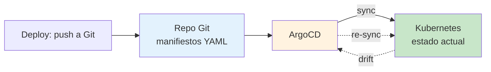

# ArgoCD – GitOps para Kubernetes

Herramienta GitOps declarativa para Kubernetes. El estado deseado de las aplicaciones se define en un repo Git, y ArgoCD sincroniza el clúster automáticamente. Complementa kubectl + Helm con auto-reconciliación.

> 🎯 **Nivel**: intermedio · **Requisitos**: Kubernetes, kubectl, Git (idealmente [Helm](./manual_helm.md)) · **Revisado**: noviembre 2026

> 📌 **Estado (nov. 2026)**: los ejemplos usan el canal `stable`; en producción **fija una versión concreta** del manifiesto (`.../argo-cd/v<X.Y.Z>/manifests/install.yaml`) y lee las notas de actualización de cada versión mayor. Los comandos `argocd` pueden variar entre versiones: verifica con `argocd --help`.

## 📋 Tabla de Contenidos

- [Conceptos GitOps](#-conceptos-gitops)
- [Instalación](#-instalación)
- [Arquitectura](#️-arquitectura)
- [CLI (argocd)](#️-cli-argocd)
- [Aplicación (App)](#-aplicación-app)
- [Sincronización](#-sincronización)
- [Projects](#️-projects)
- [ApplicationSet](#-applicationset)
- [Repos y conexiones](#-repos-y-conexiones)
- [FAQ](#-faq)
- [Enlaces](#-enlaces)

## 🧠 Conceptos GitOps



Flujo: `developer push → Git → ArgoCD detecta cambio → sync → clúster actualizado`.

Si alguien modifica el clúster directamente (kubectl edit), ArgoCD lo revierte al estado del repo.

## 🔧 Instalación

```bash
# En el clúster Kubernetes
kubectl create namespace argocd
kubectl apply -n argocd --server-side --force-conflicts \
  -f https://raw.githubusercontent.com/argoproj/argo-cd/stable/manifests/install.yaml   # fija una versión en producción

# Alternativa: Helm (chart argo/argo-cd)
# helm repo add argo https://argoproj.github.io/argo-helm && helm install argocd argo/argo-cd -n argocd

# Exponer UI
kubectl port-forward -n argocd svc/argocd-server 8080:443

# Obtener contraseña de admin
kubectl -n argocd get secret argocd-initial-admin-secret -o jsonpath="{.data.password}" | base64 -d

# Login: admin / contraseña-obtenida
# Después: cambia la contraseña, elimina el secreto inicial y configura SSO (Dex/OIDC)
```

## 🏗️ Arquitectura

```bash
# Componentes
# argocd-server    → API + UI
# argocd-repo-server → clona repos y genera manifests
# argocd-app-controller  → reconcilia estado deseado vs actual
# argocd-dex-server → autenticación (SSO, OIDC)
# argocd-redis      → caché

# Namespace: argocd
kubectl get pods -n argocd
```

## 🖥️ CLI (argocd)

```bash
# Instalar CLI
curl -sSL -o /usr/local/bin/argocd https://github.com/argoproj/argo-cd/releases/latest/download/argocd-linux-amd64
chmod +x /usr/local/bin/argocd

# Login (sin --password en la línea de comandos: quedaría en el historial; pedirá la contraseña)
argocd login localhost:8080 --username admin
# Con SSO: argocd login argocd.example.com --sso

# Listar aplicaciones
argocd app list

# Ver detalles
argocd app get mi-app

# Sincronizar manualmente
argocd app sync mi-app

# Ver historial de syncs
argocd app history mi-app

# Rollback a versión anterior
argocd app rollback mi-app 3
```

## 📦 Aplicación (App)

```yaml
# app.yaml
apiVersion: argoproj.io/v1alpha1
kind: Application
metadata:
  name: mi-app
  namespace: argocd
spec:
  project: default
  source:
    repoURL: https://github.com/user/k8s-manifests.git
    targetRevision: main
    path: apps/mi-app
    # Helm support:
    helm:
      valueFiles:
        - values-prod.yaml
  destination:
    server: https://kubernetes.default.svc
    namespace: production
  syncPolicy:
    automated:
      prune: true         # eliminar recursos que ya no están en Git
      selfHeal: true      # corregir drift automáticamente
    syncOptions:
      - CreateNamespace=true
```

```bash
argocd app create mi-app -f app.yaml
argocd app get mi-app           # ver estado + árbol de recursos
```

## 🔄 Sincronización

```yaml
# Estrategias de sync
syncPolicy:
  automated:
    prune: true                     # eliminar recursos huérfanos
    selfHeal: true                  # corregir cambios manuales
    allowEmpty: false               # no permitir que el directorio esté vacío

  # Sync phases
  # 1. PreSync hooks: migraciones DB, checks
  # 2. Sync: aplicar manifests
  # 3. PostSync hooks: tests de humo, notificaciones
```

Hooks para tareas pre/post sync:

```yaml
apiVersion: batch/v1
kind: Job
metadata:
  name: db-migration
  annotations:
    argocd.argoproj.io/hook: PreSync   # se ejecuta antes del sync
    argocd.argoproj.io/hook-delete-policy: HookSucceeded
spec:
  template:
    spec:
      restartPolicy: Never
      containers:
        - name: migrate
          image: myapp:1.4.2           # versión fija: con `latest` Git no describe el estado real
          command: ["./run_migrations.sh"]
```

**Sync waves**: ordena recursos dentro de una misma fase con la anotación `argocd.argoproj.io/sync-wave: "1"` (los números menores se aplican antes; p. ej. CRDs `-1`, aplicación `0`, comprobaciones `2`).

## 🏗️ Projects

Aislar aplicaciones por equipo/entorno con políticas:

```yaml
apiVersion: argoproj.io/v1alpha1
kind: AppProject
metadata:
  name: production
  namespace: argocd
spec:
  sourceRepos:
    - https://github.com/org/production-manifests.git
  destinations:
    - namespace: production
      server: https://kubernetes.default.svc
  clusterResourceWhitelist:
    - group: "*"
      kind: "*"
  roles:
    - name: admin
      policies:
        - p, proj:production:admin, applications, *, production/*, allow
```

## 🧬 ApplicationSet

Genera muchas `Application` desde una plantilla (varios clústeres, entornos o carpetas del repo):

```yaml
apiVersion: argoproj.io/v1alpha1
kind: ApplicationSet
metadata:
  name: apps
  namespace: argocd
spec:
  generators:
    - git:
        repoURL: https://github.com/user/k8s-manifests.git
        revision: main
        directories:
          - path: apps/*             # una Application por carpeta
  template:
    metadata:
      name: "{{path.basename}}"
    spec:
      project: default
      source:
        repoURL: https://github.com/user/k8s-manifests.git
        targetRevision: main
        path: "{{path}}"
      destination:
        server: https://kubernetes.default.svc
        namespace: "{{path.basename}}"
      syncPolicy:
        automated: { prune: true, selfHeal: true }
        syncOptions: [CreateNamespace=true]
```

Otros generadores: `list`, `clusters`, `matrix`, `pullRequest` (entornos efímeros por PR).

## 🔗 Repos y conexiones

```bash
# Añadir repo privado con SSH
argocd repo add git@github.com:org/private-repo.git \
  --ssh-private-key-path ~/.ssh/argocd_deploy

# O con HTTPS + token (usa un token de solo lectura/deploy; léelo de una variable, no lo escribas literal)
argocd repo add https://github.com/org/repo.git \
  --username token --password "$GIT_TOKEN"

# Ver repos configurados
argocd repo list

# Conectar clúster adicional (staging, DR)
argocd cluster add context-staging
argocd cluster list
```

## ❓ FAQ

**❓ Diferencia entre ArgoCD y Flux?**
➡ ArgoCD tiene UI web, mayor adopción, mejor soporte multi-clúster. Flux es más minimalista, usa menos recursos, mejor integración con SOPS.

**❓ Cómo hacer canary / blue-green con ArgoCD?**
➡ ArgoCD se integra con Argo Rollouts (proyecto aparte con su CRD `Rollout`): entrega progresiva con análisis de métricas de Prometheus.

**❓ Cómo actualizo la imagen automáticamente al publicar una nueva versión?**
➡ Con Argo CD Image Updater (o un job de CI que haga commit del nuevo tag en el repo de manifiestos). Así Git sigue siendo la fuente de verdad.

**❓ Cómo gestiono secretos en GitOps?**
➡ No los guardes en claro en Git: usa Sealed Secrets, SOPS, o External Secrets Operator.

**❓ Error "ComparisonError"?**
➡ ArgoCD no pudo generar los manifests. Revisa la sintaxis YAML, las values de Helm, o la conexión al repo.

**❓ Cómo actualizar ArgoCD?**
➡ Aplica el manifiesto de la nueva versión (o `helm upgrade` si usaste Helm) tras leer las notas de actualización; evita saltar varias versiones mayores de golpe.

## 🔗 Enlaces
- [ArgoCD Docs](https://argo-cd.readthedocs.io/)
- [ArgoCD GitHub](https://github.com/argoproj/argo-cd)
- [Argo Rollouts](https://argoproj.github.io/rollouts/)
- [GitOps Principles](https://opengitops.dev/)
- [Best Practices](https://argo-cd.readthedocs.io/en/stable/user-guide/best_practices/)

---
*Parte de la [Colección de Manuales y Cheatsheets](../README.md), por CeleroLab*
