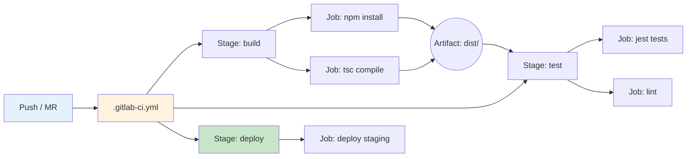

# GitLab CI/CD – Pipelines automatizados desde el repo

Plataforma de CI/CD integrada en GitLab. Pipelines declarativos en YAML (.gitlab-ci.yml) con runners propios o compartidos, ideal para proyectos con auto-deploy a Kubernetes, Docker registries y entornos.

> 🎯 **Nivel**: intermedio · **Requisitos**: Git, YAML, nociones de Docker · **Revisado**: noviembre 2026

> ⚠️ **Estado (nov. 2026)**: `only:`/`except:` están en desuso: usa **`rules:`** (este manual ya lo hace). El *registration token* de los runners también está obsoleto: se usa el **runner authentication token** (`glrt-…`) creado desde la UI ([guía de migración](https://docs.gitlab.com/ci/runners/new_creation_workflow/); la versión exacta de retirada varía según la documentación, así que compruébala en la de tu versión). Las versiones de `node:` y `docker:` de los ejemplos son orientativas: usa una LTS vigente.

## 📋 Tabla de Contenidos

- [Conceptos](#️-conceptos)
- [Pipeline básico](#-pipeline-básico)
- [Stages y jobs](#-stages-y-jobs)
- [Variables](#-variables)
- [Artefactos y caché](#-artefactos-y-caché)
- [Docker in Docker (dind)](#-docker-in-docker-dind)
- [Reglas (`rules`)](#-reglas-rules)
- [Matrices (parallel matrix)](#-matrices-parallel-matrix)
- [Entornos y despliegue](#-entornos-y-despliegue)
- [Runners](#-runners)
- [FAQ](#-faq)
- [Enlaces](#-enlaces)

## 🏗️ Conceptos

- **Pipeline**: ejecución completa de principio a fin (trigger → stages → resultado)
- **Stage**: grupo de jobs que se ejecutan en paralelo (build, test, deploy)
- **Job**: tarea individual dentro de un stage (ej: `npm run test`)
- **Runner**: agente que ejecuta los jobs (GitLab-hosted o self-hosted)
- **Artifact**: archivos generados por un job (binarios, reports, logs)



## 🚀 Pipeline básico

```yaml
# .gitlab-ci.yml (raíz del repo)

stages:
  - build
  - test
  - deploy

build-job:
  stage: build
  image: node:24
  script:
    - npm ci
    - npm run build
  artifacts:
    paths:
      - dist/

test-job:
  stage: test
  image: node:24
  script:
    - npm ci
    - npm run test
  coverage: /All files\s+\|\s+(\d+\.\d+)/   # extraer % cobertura

deploy-staging:
  stage: deploy
  image: alpine:3
  script:
    - apk add --no-cache rsync
    - rsync -avz dist/ user@server:/var/www/staging/
  rules:
    - if: $CI_COMMIT_BRANCH == $CI_DEFAULT_BRANCH
```

## 📦 Stages y jobs

```yaml
stages:
  - lint
  - build
  - test
  - deploy

# Jobs en paralelo dentro del mismo stage
lint:eslint:
  stage: lint
  script: npx eslint src/

lint:prettier:
  stage: lint
  script: npx prettier --check src/

# needs: arranca en cuanto terminan esos jobs, sin esperar al resto del stage (DAG)
deploy:production:
  stage: deploy
  needs: ["build-job", "test-job"]
  script: ./deploy.sh prod
  rules:
    - if: $CI_COMMIT_TAG      # solo en tags (releases)

# Job manual (requiere click en UI)
deploy:prod-manual:
  stage: deploy
  script: ./deploy.sh prod
  when: manual
  allow_failure: false
```

## 🔐 Variables

```yaml
# Variables predefinidas
# $CI_COMMIT_SHA, $CI_COMMIT_BRANCH, $CI_PIPELINE_ID, $CI_JOB_ID
# $CI_REGISTRY_USER, $CI_REGISTRY_PASSWORD

variables:
  NODE_ENV: production
  DOCKER_DRIVER: overlay2

# Variables protegidas/enmascaradas (Settings → CI/CD → Variables)
# Usar en scripts: $SSH_PRIVATE_KEY, $DEPLOY_TOKEN
# Para secretos de nube, mejor OIDC (`id_tokens:`) o integración con Vault antes que claves fijas

before_script:
  - echo "Pipeline $CI_PIPELINE_ID en rama $CI_COMMIT_BRANCH"

# Usar variables en comandos
script:
  - echo "Desplegando versión $CI_COMMIT_SHORT_SHA"
  - docker build -t myapp:$CI_COMMIT_SHORT_SHA .
```

## 📤 Artefactos y caché

```yaml
# Artefactos: pasar archivos entre jobs
build:
  stage: build
  artifacts:
    paths:
      - dist/
      # node_modules/ aquí no: es pesado; mejor usar cache
    expire_in: 1 week         # limpiar tras 1 semana

# Caché: reutilizar entre pipelines (node_modules)
cache:
  key: $CI_COMMIT_REF_SLUG   # por rama
  paths:
    - node_modules/
    - .npm/

# Caché con fallback a main
cache:
  key:
    files:
      - package-lock.json     # cambiar key si cambia lock
    prefix: npm-cache
  paths:
    - node_modules/
```

## 🐳 Docker in Docker (dind)

Para construir imágenes Docker dentro del pipeline:

```yaml
variables:
  DOCKER_TLS_CERTDIR: "/certs"      # TLS activo (por defecto en imágenes docker:19.03+)

build-docker:
  stage: build
  image: docker:cli                 # o fija una versión mayor concreta
  services:
    - docker:dind
  script:
    - echo "$CI_REGISTRY_PASSWORD" | docker login -u "$CI_REGISTRY_USER" --password-stdin "$CI_REGISTRY"
    - docker build -t $CI_REGISTRY_IMAGE:$CI_COMMIT_SHORT_SHA .
    - docker push $CI_REGISTRY_IMAGE:$CI_COMMIT_SHORT_SHA
  rules:
    - if: $CI_COMMIT_BRANCH == $CI_DEFAULT_BRANCH
```

> `dind` exige un runner con `privileged = true`. Alternativas sin privilegios: **Kaniko**/**Buildah**. Evita montar `/var/run/docker.sock` en runners compartidos: da control total del host.

## 🧭 Reglas (`rules`)

`rules:` sustituye a `only`/`except` y se evalúa en orden; la primera que coincide manda:

```yaml
workflow:                           # decide si se crea el pipeline entero
  rules:
    - if: $CI_PIPELINE_SOURCE == "merge_request_event"
    - if: $CI_COMMIT_BRANCH == $CI_DEFAULT_BRANCH
    - if: $CI_COMMIT_TAG

test:
  script: npm test
  rules:
    - if: $CI_PIPELINE_SOURCE == "merge_request_event"
    - changes: [src/**/*, package-lock.json]    # solo si cambian esos ficheros

deploy:
  script: ./deploy.sh
  rules:
    - if: $CI_COMMIT_TAG
      when: manual
    - when: never
```

Reutilización: `include:` (plantillas locales, remotas o de proyecto), `extends:` y los **CI/CD components** del catálogo con `include: component:`.

## 🔄 Matrices (parallel matrix)

Probar múltiples versiones/configuraciones:

```yaml
test:node:
  parallel:
    matrix:
      - NODE_VERSION: ["22", "24"]
        DB: ["postgres:17", "mysql:8"]
  image: node:${NODE_VERSION}
  services:
    - name: ${DB}
      alias: db
  script:
    - npm ci
    - npm run test

# Genera 4 jobs paralelos (2 versiones × 2 bases de datos)
```

## 🌍 Entornos y despliegue

```yaml
deploy:staging:
  stage: deploy
  environment:
    name: staging
    url: https://staging.example.com
  script:
    - rsync -avz dist/ deploy@staging:/var/www/
  rules:
    - if: $CI_COMMIT_BRANCH == $CI_DEFAULT_BRANCH

deploy:production:
  stage: deploy
  environment:
    name: production
    url: https://example.com
  script:
    - cap production deploy
  rules:
    - if: $CI_COMMIT_TAG
      when: manual      # requiere aprobación manual

# Rollback
rollback:production:
  stage: deploy
  script:
    - cap production deploy:rollback
  environment:
    name: production
    action: rollback
  when: manual
```

## ⚡ Runners

```bash
# Runners compartidos (GitLab SaaS): no requieren configuración
# Runners específicos (self-hosted):

# 1. Crear el runner en la UI (Settings → CI/CD → Runners → New project runner)
#    y copiar el authentication token (glrt-…); el registration token está obsoleto
sudo gitlab-runner register \
  --non-interactive \
  --url https://gitlab.com/ \
  --token "$RUNNER_TOKEN" \
  --executor docker \
  --docker-image alpine:3

# 2. Tags para asignar jobs a runners específicos
build:
  tags:
    - docker
    - gpu
  script: ./build.sh

# Tipos de executor: docker, shell, kubernetes, ssh, parallels
```

## ❓ FAQ

**❓ Diferencia entre GitLab CI y GitHub Actions?**
➡ GitLab CI tiene el pipeline en el repo (YAML), runners propios, y mejor integración con auto DevOps. GitHub Actions tiene marketplace de acciones y mejor integración con ecosistema GitHub.

**❓ Cómo evitar que un job corra en MRs?**
➡ Usa `rules:` y no incluyas el evento de MR: `rules: [{ if: '$CI_COMMIT_BRANCH == $CI_DEFAULT_BRANCH' }, { if: '$CI_COMMIT_TAG' }]`. Con `workflow:rules` también evitas pipelines duplicados (rama + MR).

**❓ Cómo debuggear un pipeline?**
➡ Añade `script: - printenv | sort` para ver variables. Usa `--trace` en runner local.

**❓ Error "Job failed: exit code 1"?**
➡ Revisa los logs del job. Añade `set -x` al inicio del script para traza.

## 🔗 Enlaces
- [GitLab CI Docs](https://docs.gitlab.com/ci/)
- [.gitlab-ci.yml reference](https://docs.gitlab.com/ci/yaml/)
- [Reglas (`rules`)](https://docs.gitlab.com/ci/jobs/job_rules/)
- [GitLab Runner](https://docs.gitlab.com/runner/)
- [Auto DevOps](https://docs.gitlab.com/topics/autodevops/)

---
*Parte de la [Colección de Manuales y Cheatsheets](../README.md), por CeleroLab*
