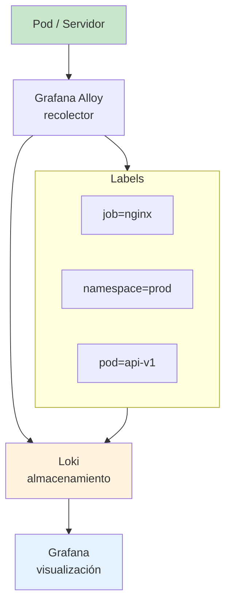

# Loki – Logging centralizado (como Prometheus, pero para logs)

Sistema de agregación de logs horizontalmente escalable, inspirado en Prometheus. Sin indexación de texto completo, etiqueta los logs con labels y los comprime, ideal para Kubernetes y entornos cloud-native.

> 🎯 **Nivel**: intermedio · **Requisitos**: Docker o Kubernetes, nociones de Grafana y Prometheus · **Revisado**: noviembre 2026

> ⚠️ **Estado (nov. 2026)**: **Promtail llegó a su fin de vida el 2 de marzo de 2026**: ya no tiene soporte ni actualizaciones y todo el desarrollo continúa en **Grafana Alloy** ([aviso oficial](https://grafana.com/docs/loki/latest/send-data/promtail/)). La deprecación no incluye el cliente `lambda-promtail`. El chart Helm `loki-stack` también está obsoleto en favor de `grafana/loki`. Este manual usa Alloy como recolector.

## 📋 Tabla de Contenidos

- [Conceptos](#-conceptos)
- [Instalación](#-instalación)
- [Arquitectura](#️-arquitectura)
- [Grafana Alloy (recolector)](#-grafana-alloy-recolector)
- [Migrar desde Promtail](#-migrar-desde-promtail)
- [LogQL (consulta de logs)](#-logql-consulta-de-logs)
- [Grafana + Loki](#-grafana--loki)
- [FAQ](#-faq)
- [Enlaces](#-enlaces)

## 🧠 Conceptos

| Prometheus | Loki |
|------------|------|
| Métricas numéricas | Logs de texto |
| PromQL | LogQL |
| Service Discovery + scrape | Grafana Alloy (o Fluent Bit, OTel Collector) recolectan |
| TSDB (índice + chunks) | Índice (solo labels) + chunks comprimidos |
| Alertmanager | Grafana Alerting |

Ventaja clave de Loki vs ELK: **sin indexación de texto completo** → más barato de operar, menos RAM, mismo tagging que Prometheus.

> 💡 **Regla de oro**: los labels deben tener **baja cardinalidad** (`namespace`, `app`, `level`). No uses como label valores únicos (IP, `request_id`, usuario): crean demasiados streams y degradan Loki. Para eso usa filtros de línea o *structured metadata*.

## 🔧 Instalación

```bash
# Docker Compose (rápido para desarrollo): sigue la guía oficial
# https://grafana.com/docs/loki/latest/setup/install/docker/

# Helm (Kubernetes): chart grafana/loki (el chart loki-stack está obsoleto)
helm repo add grafana https://grafana.github.io/helm-charts
helm repo update
helm upgrade --install loki grafana/loki -n monitoring --create-namespace \
  -f loki-values.yaml        # p. ej. deploymentMode: SingleBinary para empezar

# Binario simple (testing)
wget https://github.com/grafana/loki/releases/latest/download/loki-linux-amd64.zip
unzip loki-linux-amd64.zip && ./loki-linux-amd64 -config.file=loki-config.yaml
```

## 🏗️ Arquitectura



Componentes:
- **Grafana Alloy**: agente (distribución de OpenTelemetry Collector) que recolecta logs, añade labels y los envía a Loki
- **Loki**: almacena logs comprimidos con índice mínimo por labels
- **Grafana**: consulta y visualiza logs con LogQL (datasource Loki)

## 📤 Grafana Alloy (recolector)

Alloy se configura en su propia sintaxis (ficheros `.alloy`) conectando componentes entre sí:

```alloy
// config.alloy

// Destino común
loki.write "default" {
  endpoint {
    url = "http://loki:3100/loki/api/v1/push"
  }
}

// 1) Ficheros de log del sistema
local.file_match "varlogs" {
  path_targets = [{"__path__" = "/var/log/*.log", "job" = "varlogs"}]
}

loki.source.file "varlogs" {
  targets    = local.file_match.varlogs.targets
  forward_to = [loki.write.default.receiver]
}

// 2) Contenedores Docker
discovery.docker "containers" {
  host = "unix:///var/run/docker.sock"
}

discovery.relabel "docker" {
  targets = discovery.docker.containers.targets
  rule {
    source_labels = ["__meta_docker_container_name"]
    target_label  = "container"
  }
}

loki.source.docker "containers" {
  host       = "unix:///var/run/docker.sock"
  targets    = discovery.relabel.docker.output
  forward_to = [loki.write.default.receiver]
}

// 3) Pods de Kubernetes
discovery.kubernetes "pods" {
  role = "pod"
}

discovery.relabel "pods" {
  targets = discovery.kubernetes.pods.targets
  rule {
    source_labels = ["__meta_kubernetes_pod_label_app"]
    target_label  = "app"
  }
  rule {
    source_labels = ["__meta_kubernetes_namespace"]
    target_label  = "namespace"
  }
}

loki.source.kubernetes "pods" {
  targets    = discovery.relabel.pods.output
  forward_to = [loki.process.pods.receiver]
}

loki.process "pods" {
  stage.regex {
    expression = "^(?P<level>\\w+)\\s+(?P<message>.+)$"
  }
  stage.labels {
    values = { level = "" }
  }
  forward_to = [loki.write.default.receiver]
}
```

```bash
# Ejecutar Alloy
alloy run config.alloy

# En Kubernetes: chart grafana/alloy
helm upgrade --install alloy grafana/alloy -n monitoring -f alloy-values.yaml
```

## 🔁 Migrar desde Promtail

```bash
# Convertir un promtail-config.yaml existente a configuración Alloy
alloy convert --source-format=promtail --output=config.alloy promtail-config.yaml

# Comprobar que la conversión es válida antes de aplicarla
alloy convert --source-format=promtail --bypass-errors --report=report.txt \
  --output=config.alloy promtail-config.yaml
```

Revisa siempre el informe: algunas etapas (`pipeline_stages`) no tienen equivalente directo y requieren ajuste manual. Según la documentación de Alloy:

- `alloy convert` es de **public preview** y convierte configuraciones de Promtail **v2.8.x**; `--bypass-errors` hace una conversión de mejor esfuerzo.
- Como paso transitorio puedes arrancar Alloy directamente con la configuración de Promtail (`alloy run --config.format=promtail promtail-config.yaml`), sin guardar la conversión.
- La configuración de trazas de Promtail no se migra automáticamente, y las **métricas de Alloy son distintas**: revisa dashboards y alertas que dependan de las de Promtail.

## 🔍 LogQL (consulta de logs)

LogQL es el lenguaje de consulta de Loki: mezcla de PromQL + grep:

```logql
# Consulta básica
{job="nginx"}                                                              # todos los logs de nginx
{namespace="production", app="api"}                                         # filtro por labels
{job="nginx"} |= "ERROR"                                                    # contiene "ERROR"
{job="nginx"} |~ "error|timeout"                                           # regex
{job="nginx"} != "healthcheck"                                             # NO contiene

# Filtros por nivel
{app="api"} | json | level = "error"                                       # parsear JSON en línea
{app="api"} | logfmt | severity = "error"                                  # parsear logfmt

# Métricas sobre logs (como PromQL)
rate({job="nginx"} |= "ERROR" [5m])                                        # tasa de errores
sum by(level) (count_over_time({app="api"} | json [5m]))                   # conteo por nivel

# Ejemplos prácticos
# Top 5 IPs con más errores 4xx
topk(5, sum by(remote_addr) (count_over_time({job="nginx"} |~ " 4[0-9]{2} " [5m])))

# Latencia p99 desde logs de acceso
quantile_over_time(0.99, {job="nginx"} | pattern `<ip> - - <_> "<method> <_> <status> <size> <_> "<_>" <latency>` | unwrap latency [5m])
```

## 📊 Grafana + Loki

```bash
# 1. Añadir datasource Loki en Grafana
# Connections → Data sources → Add → Loki
# URL: http://loki:3100

# 2. Crear panel de logs
# Dashboard → New → Visualization → Select Loki
# Query: {namespace="production"} |= "ERROR"
```

En Grafana, el panel tipo `Logs` muestra logs con:
- Barra de tiempo integrada (timeline de volumen)
- Highlight de palabras clave
- Expandir cada log línea por línea
- Enlace directo a métricas relacionadas (desde labels compartidas)

## ❓ FAQ

**❓ Loki vs ELK (Elasticsearch + Logstash + Kibana)?**
➡ Loki es más simple, barato de operar (sin indexación de texto completo), se integra nativamente con Prometheus labels. ELK tiene una búsqueda de texto completo más potente, Kibana más maduro para dashboards, pero requiere más recursos.

**❓ Cómo buscar texto libre en Loki si no hay indexación de texto completo?**
➡ Usa `|= "texto"` (line filter) que busca substring en el contenido. Es eficiente porque Loki solo lee las líneas comprimidas que matchean los labels.

**❓ Cómo retener logs por tiempo?**
➡ En Loki 3.x la retención la aplica el **compactor** (el antiguo `table_manager` ya no se usa):
```yaml
limits_config:
  retention_period: 720h          # 30 días
compactor:
  working_directory: /loki/compactor
  retention_enabled: true
  delete_request_store: filesystem
```
`delete_request_store` es obligatorio al activar la retención (sin él Loki no arranca) y la retención exige periodo de índice de 24 h.

**❓ Cómo reducir el costo de almacenamiento?**
➡ Evita labels de alta cardinalidad, ajusta `chunk_target_size` (≈1.5 MB por defecto) y establece un retention period adecuado.

## 🔗 Enlaces
- [Documentación Loki](https://grafana.com/docs/loki/latest/)
- [LogQL reference](https://grafana.com/docs/loki/latest/query/)
- [Grafana Alloy](https://grafana.com/docs/alloy/latest/)
- [Migrar de Promtail a Alloy](https://grafana.com/docs/alloy/latest/set-up/migrate/from-promtail/)
- [Retención en Loki](https://grafana.com/docs/loki/latest/operations/storage/retention/)
- [Loki vs ELK comparison](https://grafana.com/compare/loki-vs-elasticsearch/)

---
*Parte de la [Colección de Manuales y Cheatsheets](../README.md), por CeleroLab*
