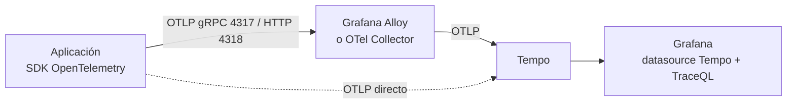

# Grafana Tempo – Trazas distribuidas con OpenTelemetry

Backend de trazas de Grafana Labs: almacena trazas que recibe por OTLP y las consulta con **TraceQL** desde Grafana. Completa la pila de observabilidad de esta colección: métricas ([Prometheus](./manual_prometheus.md)), logs ([Loki](./manual_loki.md)) y trazas (Tempo), todo visualizado en [Grafana](./manual_grafana.md).

> 🎯 **Nivel**: intermedio · **Requisitos**: Docker, nociones de OpenTelemetry y de Grafana · **Revisado**: noviembre 2026

> 📌 **Estado (nov. 2026)**: Tempo 3.0 introdujo una arquitectura nueva (se eliminaron los targets `ingester`, `compactor` y `scalable-single-binary`) y eliminó el receptor **OpenCensus**. El modo *single binary* (monolítico) sigue documentado y no requiere Kafka. Las configuraciones de este manual son mínimas para evaluación; **contrástalas con la guía de tu versión** ([instalación local en Linux, v3.0](https://grafana.com/docs/tempo/v3.0.x/set-up-for-tracing/setup-tempo/deploy/locally/linux/)).

## 🧠 Conceptos



- **Traza**: recorrido de una petición por varios servicios; formada por **spans** (operaciones con inicio, duración, atributos y estado).
- **OTLP**: protocolo estándar de OpenTelemetry. Tempo lo recibe por **gRPC (puerto 4317)** y, si se habilita, por **HTTP (puerto 4318)**.
- **TraceQL**: lenguaje de consulta para seleccionar trazas por atributos, duración o estado.
- Tempo guarda las trazas en almacenamiento de objetos (S3, GCS, Azure) o, para pruebas, en disco local.

## 🚀 Prueba rápida: todo en un contenedor

La imagen `grafana/otel-lgtm` agrupa un backend OpenTelemetry completo (Grafana, Tempo, Loki y Prometheus) pensado para desarrollo local ([presentación](https://grafana.com/blog/an-opentelemetry-backend-in-a-docker-image-introducing-grafana-otel-lgtm/)):

```bash
docker run --rm -p 3000:3000 -p 4317:4317 -p 4318:4318 grafana/otel-lgtm
# Grafana en http://localhost:3000 · OTLP en 4317 (gRPC) y 4318 (HTTP)
```

Úsala para aprender y probar la instrumentación; no es una configuración de producción.

## 🔧 Tempo en modo single binary

```yaml
# tempo.yaml: configuración mínima para evaluación (almacenamiento local)
server:
  http_listen_port: 3200

distributor:
  receivers:
    otlp:
      protocols:
        grpc:
          endpoint: "0.0.0.0:4317"      # ver nota: por defecto escucha solo en localhost
        http:
          endpoint: "0.0.0.0:4318"

storage:
  trace:
    backend: local
    wal:
      path: /var/tempo/wal
    local:
      path: /var/tempo/blocks
```

```bash
# Fija la versión de la imagen (no uses :latest); el binario se invoca con --config.file
docker run -d --name tempo \
  -p 3200:3200 -p 4317:4317 -p 4318:4318 \
  -v "$PWD/tempo.yaml:/etc/tempo.yaml:ro" \
  -v tempo-data:/var/tempo \
  grafana/tempo:<version> --config.file=/etc/tempo.yaml
```

> **Importante**: desde Tempo 2.7 el receptor OTLP escucha por defecto en `localhost` en lugar de `0.0.0.0`. Si envías trazas desde otro contenedor o equipo, indica el `endpoint` explícito como arriba. El almacenamiento local solo sirve para evaluación o una sola máquina.

## 📤 Enviar trazas desde tu aplicación

Los SDK de OpenTelemetry se configuran con variables de entorno estándar:

```bash
export OTEL_SERVICE_NAME=checkout
export OTEL_EXPORTER_OTLP_ENDPOINT=http://localhost:4318
export OTEL_EXPORTER_OTLP_PROTOCOL=http/protobuf
# Después ejecuta tu aplicación con el SDK o el agente de OpenTelemetry de tu lenguaje
```

En producción es habitual enviar las trazas a un **colector** (Grafana Alloy con el componente `otelcol.receiver.otlp`, o el OpenTelemetry Collector) que añade atributos, hace muestreo y reenvía a Tempo con OTLP ([guía de Tempo para colectores](https://grafana.com/docs/tempo/next/set-up-for-tracing/instrument-send/set-up-collector/otel-collector/)). Alloy también recolecta logs: ver [Loki](./manual_loki.md).

## 🔎 Grafana: conectar Tempo y consultar con TraceQL

```bash
# Connections → Data sources → Add data source → Tempo
# URL: http://tempo:3200
# Explore → seleccionar Tempo → pestaña TraceQL
```

```traceql
{ status = error }                                             // spans con error
{ resource.service.name = "checkout" && duration > 500ms }     // lentos de un servicio
{ span.http.status_code >= 500 }                               // por atributo del span
```

- `resource.` accede a atributos del recurso (servicio, host); `span.` a atributos del span; `status` y `duration` son intrínsecos.
- El editor visual (*query builder*) de Explore ayuda a componer consultas sin escribirlas.
- Referencia: [TraceQL](https://grafana.com/docs/tempo/next/traceql/).
- **Traces Drilldown** (Grafana) permite explorar trazas con métricas RED sin escribir TraceQL.

### Correlacionar trazas, logs y métricas

En el datasource de Tempo puedes configurar enlaces a Loki (logs de una traza) y a Prometheus; así saltas de un span lento a sus logs. Para que funcione, los logs deben incluir el `trace_id` (por ejemplo, mediante la instrumentación de OpenTelemetry).

## ❓ FAQ

**❓ No llegan trazas y no hay errores.**
➡ Comprueba el `endpoint` del receptor (localhost frente a `0.0.0.0`), que el puerto 4317/4318 está publicado y que el SDK usa el protocolo correcto (gRPC en 4317, HTTP en 4318).

**❓ Mi colector usaba el exportador `opencensus`.**
➡ Tempo 3.0 elimina el receptor OpenCensus: cambia a los exportadores `otlp` u `otlphttp`.

**❓ ¿Tempo o Jaeger?**
➡ Ambos almacenan trazas. Tempo se integra de forma nativa con Grafana, Loki y Prometheus y usa almacenamiento de objetos; Jaeger aporta su propia interfaz. Elige según el resto de tu pila.

**❓ ¿Puedo usar Grafana Cloud?**
➡ Sí, pero tiene un endpoint distinto para enviar (pasarela OTLP) y para consultar (`/tempo`).

## 🔗 Enlaces
- [Documentación de Tempo](https://grafana.com/docs/tempo/latest/)
- [TraceQL](https://grafana.com/docs/tempo/next/traceql/)
- [Enviar spans por HTTP (OTLP)](https://grafana.com/docs/tempo/latest/api_docs/pushing-spans-with-http/)
- [Datasource Tempo en Grafana](https://grafana.com/docs/grafana/latest/datasources/tempo/)
- [OpenTelemetry](https://opentelemetry.io/)

## 🧩 Ver también
- [Observabilidad (OpenTelemetry)](./manual_observabilidad.md) · [Prometheus](./manual_prometheus.md) · [Grafana](./manual_grafana.md) · [Loki](./manual_loki.md)

---
*Parte de la [Colección de Manuales y Cheatsheets](../README.md), por CeleroLab*
